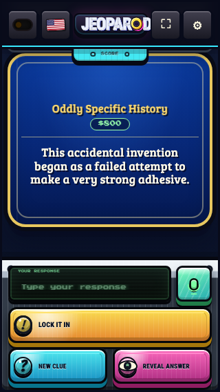
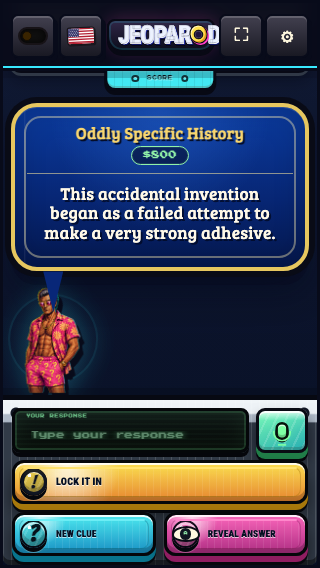
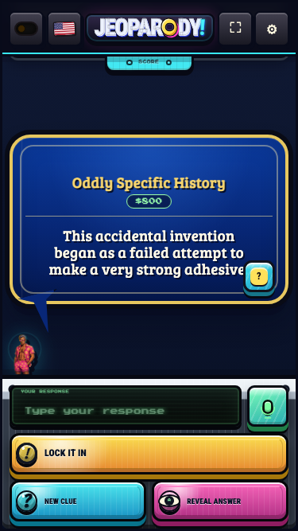
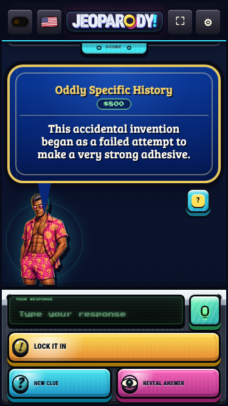
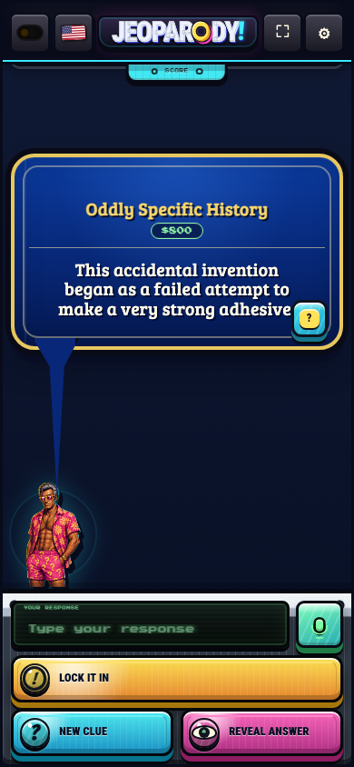
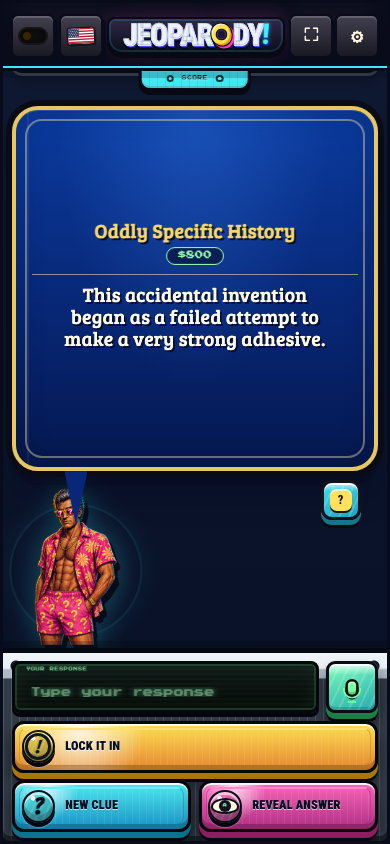
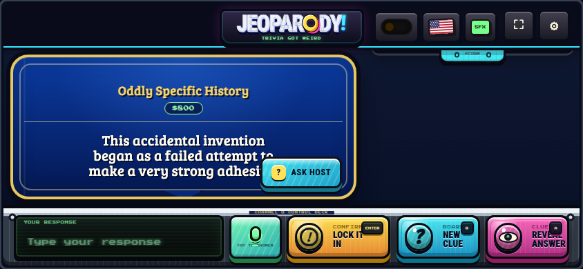
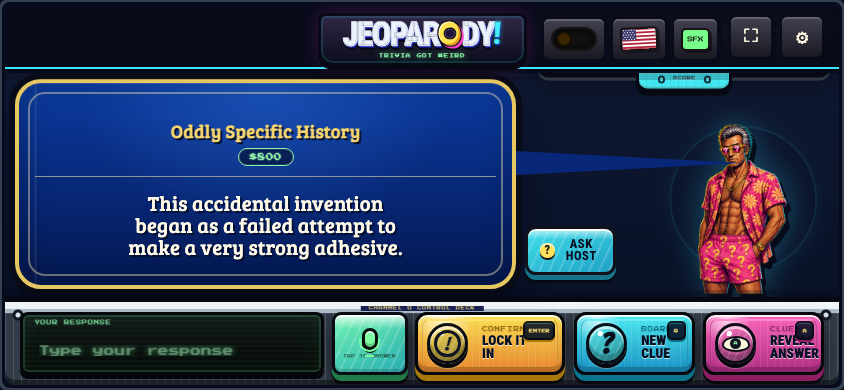

# Current repository audit and mobile repairs

Verified October 10, 2026. Scope: **AlexBaldman/Jeopardish**. The separate
future-architecture repository was not changed.

## What actually reached GitHub and production

| Evidence | Verified result |
| --- | --- |
| Remote default branch | `master`, `379ba9d1f9413d8b7283bd5f13cbd1bb11d19197`, August 15 |
| Remote docs branch | `docs/uiniverse-big-bang-2026-08-08`, `94356a7241e309ed847f55e6d5481c76ae813c6f` |
| GitHub comparison | Docs branch is 1 commit ahead and 15 behind master; the merge-base diff is one added 279-line document |
| Architecture document | Master independently added it in `c699b5c`; its text is byte-identical to `94356a7` (SHA-256 `7eb929e09f36e58d9b22530f0ffc43c9085ca4c0cf077963629339d9f372bc4f`) |
| Local-only consolidation | Old checkout has unpushed `b239e43` with a 703-line document; it remains untouched, along with `.devin/` and the local summary |
| Merge history / PR association | No merge of that docs branch was found. GitHub associates neither `94356a7` nor `c699b5c` with a PR. Master has the independently committed document plus later runtime/user work |
| Pages deployment | Deployment `5918655726` reports success at master `379ba9d`, August 15, at https://alexbaldman.github.io/Jeopardish/ |
| Latest master workflow | [31873637965](https://github.com/AlexBaldman/Jeopardish/actions/runs/31873637965): validation and deployment succeeded; subsequent WebKit canary failed during classic-mode clue advancement |
| Recent green CI | Runs on separate PR branches, including [36859402308](https://github.com/AlexBaldman/Jeopardish/actions/runs/36859402308); deploy/canary skipped. These do not establish a newer production deployment |

This is independent document promotion, not evidence of the reported giant
branch merge. The scene art, wardrobe, controller extraction, and other large
changes described by Devin are already in the shared history through `ab86c4f`.
Master subsequently added `9bd8516` (host/dialogue/scoreboard work), documentation,
and `379ba9d` (classic random play and cabinet changes).

A direct checkout of the remote docs branch would remove newer work: the current
two-tree comparison spans 92 files, 945 additions, and 11,367 deletions. The old
local branch's two commits are also 15 commits behind current master. Do not
interpret “two commits ahead” as safe integration or a complete history audit.

## Devin summary: claim reconciliation

- **418 files / 472,519 insertions / 11,684 deletions:** not the current remote
  merge-base delta, nor the current two-tree delta. Its exact historical baseline
  is not supplied and cannot be authenticated from the summary.
- **234 passing tests:** current untouched master has **280 passing tests**.
  Repair branch has **287**, adding connector/fullscreen regression cases.
- **699-line app / 1,027-line renderer:** describes the older docs branch, not
  current master: **723 / 1,213** before this repair. Line count is not a reason
  to undo later behavior.
- **703 vs. 279-line architecture conflict:** the 703-line version is local-only.
  Remote master and remote docs branch already contain the same 279-line content.
  Preserve the local consolidation as proposed material; no conflict resolution
  or architecture rewrite is needed for the mobile repair.
- **5.47 MB cold transfer:** not reproduced on current production. Live smoke
  measured roughly **7.2–7.6 MB**, within the existing 10 MB route budget.
  Variation follows the selected host look. Whole built artifact is **36.5 / 38 MB**.
- **180 visual states:** current harness captures **210** (seven viewports,
  two themes, fifteen states). Existing containment checks did not enforce a
  minimum host size or the actual tail endpoint.
- **“Original assets” / “ready for integration”:** runtime PNGs and provenance
  records exist, but current project documents still hold commercial approval
  and incomplete transformation lineage. Presence of artwork and passing tests
  do not settle those decisions.
- **Channel O / episode-centric canon:** these remain exploratory. Documentation
  now explicitly separates these directions from current runtime facts.

## Regressions and preserved work

The mobile sizing regression is traceable to `379ba9d`: its portrait formula
`clamp(42px, min(28cqw, calc(36svh - 208px)), 132px)` produces a **42px-wide**
host at 375×667 and hides the host at 320×568 and in phone landscape. Previous
master used larger portrait sizing. This is a presentation defect, not a reason
to revert the entire classic-controls commit.

Dialogue tracking measured a mouth target, but the connector was capped at
180px, rotated in the wrong CSS direction for horizontal offsets, and drawn
with a jagged fixed polygon. A far-away mouth or a host beside the card could
not be reached accurately. The repair uses the measured card and avatar, border
offsets, an exact distance/rotation, and an appropriate bottom or side attachment.
Narration has no host tail; hidden hosts leave no dangling tail.

Portrait layout reserves space for a 112–148px host; 320×568 uses 88px. Landscape
places the host beside the card, above the controls. On short phones, detailed
translation and outcome-review panels temporarily use that space for content.
The host does not cover clue text or answer controls.
The shortest portrait layout keeps 44px control targets to leave room for the
complete standard clue. Ask Host sits outside the clue text; landscape allows
the connector to extend beyond the card instead of clipping it.

Native fullscreen reproduced successfully in desktop Chromium and WebKit on
the baseline. Unsupported/rejected element fullscreen uses a viewport-filling
game view. The repair fixes fallback sizing precedence for desktop and landscape,
including the embedded source cabinet, adds a visible limitation explanation,
and uses “Expand game” / “Exit expanded view” labels. It handles capability flags,
prefixed WebKit requests, ignored/rejected requests, rapid clicks, browser exit
events, Escape, and restoration of the prior scroll position.
The short expansion notice sits inside the scene, above the answer controls,
and is checked against both clue and control bounds.

Arbitrary-element fullscreen depends on browser capability and permission;
JavaScript cannot promise to remove iPhone browser chrome. See the
[Fullscreen API documentation](https://developer.mozilla.org/en-US/docs/Web/API/Fullscreen_API)
and [requestFullscreen requirements](https://developer.mozilla.org/en-US/docs/Web/API/Element/requestFullscreen).
Capability emulation and WebKit checks are **not physical iPhone verification**.

Preserved: controller/view boundaries, wardrobe/art assets, classic random play,
explicit episode mode, scoring, host personalities, learning ledger, Study,
media fallback, scoreboard pin/peek behavior, and all unrelated master commits.
No reset, merge, branch deletion, deployment, or donor migration was performed.

## Before / after

Matching clue fixture, host artwork, viewport, and disabled animation:

| Viewport | Before | After |
| --- | --- | --- |
| 320×568 |  |  |
| 375×667 |  |  |
| 390×844 |  |  |
| 844×390 |  |  |

## Verification

- `npm run verify`: 287 unit tests, JavaScript syntax, convergence, CSS ownership,
  assets, 12 host looks, questions, production build and artifact audit pass.
- Production smoke: Chromium + WebKit, both built routes, emergency transport
  fallback, six non-repeating classic clues, and explicit episode mode pass.
- Live baseline smoke: same checks pass in both engines. The historical WebKit
  canary failure did not recur; its original cause remains unproven. No blind
  retry or suppression was added to the gate.
- Complete Season Zero and blocked-media standby proofs pass in both engines.
- Accessibility: 40 browser/viewport/state combinations, no critical or serious
  violations; 26–27 rules pass per state.
- Existing visual harness: 210 state captures with no geometry failures.
- `npm run test:mobile`: 112 presentation states, seven viewports, both engines,
  four skins, both themes; checks minimum host size, clue/control overlap, cabinet
  bounds, complete standard-clue containment, unclipped tails, Ask Host placement,
  and rendered connector endpoint within 2px of the measured mouth.
  Native browser exit and missing/rejected fullscreen are checked separately,
  including portrait, landscape, and desktop expansion and both toggle buttons.
- The new mobile gate is in `verify:release` and PR CI. Evidence is uploaded on
  failure. Production still deploys only through the existing non-PR workflow.

## Rollback and next improvements

Use the focused runtime repair commits as the reversible unit. If their
presentation causes an unforeseen regression, revert those code commits newest
first in a new branch/PR; retain the audit and subsequent unrelated work.
The separate audit commit is `5989d99`. Reverting `379ba9d` wholesale would also remove
classic random play and good controls, so it is not recommended. A deployment
or merge requires separate approval.

Next high-leverage work:

1. Physical iPhone Safari acceptance: browser chrome expansion/collapse, keyboard,
   rotation, safe areas, and repeated enter/exit. Emulation cannot establish these.
2. Keep runtime/deployment claims tied to commit IDs and automate document drift
   checks; the stale summary and README obscured real production behavior.
3. Measure responsive host variants and scene delivery. The artifact is close to
   its total budget; smaller artwork variants can reduce transfer while preserving
   the new mobile presence.
4. Reconcile the public historical bank with the intended release/content boundary.
   Classic Random already ships publicly; older plans incorrectly describe it as
   private-only. Resolve the product/content decision explicitly without silently
   changing the user’s preferred mode.
5. Retain meaningful geometry and gameplay checks rather than CSS-text assertions
   that required the exact broken 42px formula. Broader architecture and canon
   changes should be independent proposals.
